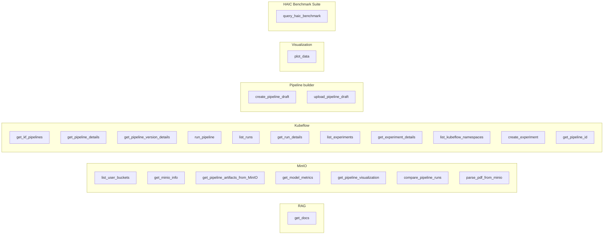

# Agents and tools

## Agent definition

The assistant’s behaviour is defined by a **system prompt** in [agents/system.md](../../agents/system.md). It states:

- **Role**: HumAIne Swarm Assistant; support for AI/ML development and MLOps (Kubeflow, MinIO, project knowledge).
- **Responsibilities**: Support ML workflows; understand queries; call appropriate tools; synthesize and respond.
- **Tool guidelines**: Use `list_user_buckets()` first for MinIO; required params for `compare_pipeline_runs`; distinction between **run_id** (Kubeflow) and **run_name** (MinIO path).
- **Context**: Use prior messages to tailor answers.
- **Security**: Do not share credentials or sensitive details; refuse off-topic or harmful requests.

The prompt is loaded in [agents/code.py](../../agents/code.py) via **`read_prompt('system')`**, which reads `agents/system.md` and appends the current date and a short note about incorporating function results. The result is set as the initial system message in session on chat start ([app.py](../../app.py) `start_chat()`).

## Tool definitions

[agents/definition.py](../../agents/definition.py) exports a list **`functions`**: OpenAI function-calling schemas (`type`, `function.name`, `function.description`, `function.parameters`). This list is imported in [utils/config.py](../../utils/config.py) and passed as **`settings["tools"]`** to every `client.responses.create()` call. The model uses these schemas to decide when and how to call tools.

## Tool implementation

[agents/code.py](../../agents/code.py) implements each tool as an **async function** and registers it in **`function_map`** (name → callable). [app.py](../../app.py) looks up by name in `function_map` and executes with the parsed JSON arguments. Tool functions are decorated with **`@cl.step(type="tool", ...)`** so Chainlit shows tool activity in the UI.

## Tools by domain

### RAG

- **get_docs(query)**  
  Uses **LlamaIndex**: `PineconeVectorStore` (index from [utils/config.py](../../utils/config.py): `PINECONE_INDEX`), `VectorStoreIndex`, `VectorIndexRetriever` with **similarity_top_k=10**. Retrieves nodes, then formats with **`rag_extract_deliverables()`** from [utils/helper_functions.py](../../utils/helper_functions.py) (list of `{text: node content}`).  
  **Note**: `optimize_query()` exists in code.py but is **not called** by `get_docs`; the user query is used as-is.

### MinIO

All MinIO tools use a **user-scoped client**: **`get_user_minio_client()`** in code.py, which calls **`UserSessionManager.get_or_refresh_minio_credentials()`** and then **`get_minio_client(user_credentials)`** from helper_functions. If no user credentials are available, it falls back to env-based client.

- **list_user_buckets(max_buckets)** — List buckets; optional ML/pipeline hints from paths.
- **get_minio_info(bucket_name, prefix?, max_items?)** — List objects under bucket/prefix.
- **get_pipeline_artifacts_from_MinIO(bucket_name, pipeline_name?, run_name?, artifact_type?, max_items?, object_path?)** — List or fetch artifacts; `object_path` can retrieve a single file.
- **get_model_metrics(bucket_name, pipeline_name?, run_name?, model_name?, max_items?, metrics_path?)** — Load metrics JSON(s) from `metrics/` paths.
- **get_pipeline_visualization(bucket_name, pipeline_name?, run_name?, visualization_type?, model_name?, visualization_path?)** — Fetch HTML (e.g. confusion matrix, ROC, feature importance).
- **compare_pipeline_runs(bucket_name, pipeline_name, run_names, metric_names?)** — Aggregate metrics across runs; compute best run per metric.

These three tools read `kubeflow/<pipeline_name>/<run_name>/` in the bucket, where pipelines name the run folder after the Kubeflow **run_id**. `_resolve_run_folder()` accepts a run's display name too: when no folder matches `run_name`, it looks the name up with `list_runs` (display_name filter, user namespace) and uses that run's ID. If that fails, the tool returns an error listing the available run folders. `get_pipeline_visualization` and `get_model_metrics` also normalise `model_name`, so "Random Forest" matches `random_forest` files and `model_type`. `get_model_metrics` and `compare_pipeline_runs` attach each run's `parameters` via `_run_parameters()`: `metadata/run_parameters.json` (`{"parameters": {...}}`) first, else the `hyperparameters` in `metadata/run_summary.json`. `compare_pipeline_runs` ranks only numeric metrics, since metrics files also hold labels and nested dicts. `get_pipeline_visualization` also draws the chart: `_visualization_figure()` parses the page's table (2x2 confusion matrix with an `actual \ predicted` header, ROC points with threshold / FPR / TPR, or feature / weight rows) into a Plotly heatmap, curve or horizontal bar chart and returns it as `figure_json`, which app.py shows as a `cl.Plotly` element. Pages in any other format get no chart.
- **parse_pdf_from_minio(bucket_name, object_path, summarize?, chunk_size?, chunk_overlap?, summary_type?)** — Download PDF from MinIO, extract text (PyPDFLoader), chunk (RecursiveCharacterTextSplitter), optional LangChain summarization; can send PDF to UI as `cl.Pdf`.

### Kubeflow

Kubeflow tools use **`get_user_kubeflow_client()`** in code.py: it reads the session Keycloak bearer token and optional namespace, then creates a client via **`get_kubeflow_client()`** in helper_functions (`kfp.Client(host, existing_token=..., namespace=...)`). A missing token raises **ValueError**; there is no username/password prompt. Namespaced calls (runs, experiments) pick their namespace with **`resolve_kubeflow_namespace()`**, which uses the profile namespaces discovered at chat start (see [04-session-and-auth.md](04-session-and-auth.md)).

- **get_kf_pipelines**, **get_pipeline_details**, **get_pipeline_version_details**, **run_pipeline**, **list_runs**, **get_run_details**, **list_experiments**, **get_experiment_details**, **list_kubeflow_namespaces**, **create_experiment**, **get_pipeline_id** — All implemented in code.py; delegate to the KFP client and map responses to dicts.

**Version defaulting in `run_pipeline`.** KFP needs a version to run a stored pipeline. When `pipeline_id` is given without `version_id`, `run_pipeline` runs the newest version (`_latest_pipeline_version()`, `list_pipeline_versions(sort_by="created_at desc", page_size=1)`), and the tool description tells the model to omit `version_id` unless the user asks for a specific one. This stops the model from reusing a stale version ID from earlier in the chat after a new version is uploaded. The returned `pipeline_version_id` is the version that actually ran.

**MinIO credential injection in `run_pipeline`.** Pipelines that read or write MinIO (for example the Smart Cities `smart-cities-auto-correction-classifier`) declare `minio_access_key`, `minio_secret_key` and `minio_session_token` input parameters. When `run_pipeline` gets a `pipeline_id`, it reads the pipeline version's `pipeline_spec["root"]["inputDefinitions"]["parameters"]` via **`_pipeline_input_names()`** (the latest version when `version_id` is omitted). If the spec declares `minio_session_token` and the caller left any of the three params missing or empty, they are filled from **`UserSessionManager.get_or_refresh_minio_credentials()`** (the user's STS `access_key` / `secret_key` / `session_token`). Non-empty values passed by the caller are kept. With no session credentials the tool returns `{"error": ...}` and does not start the run. Runs from `pipeline_package_path` are not touched. Secrets are never logged, and the returned `params` show `"<injected from session>"` for injected keys. The tool description tells the model never to ask the user for these params.

Caveat: the injected keys are temporary STS credentials, but they are stored as plain run parameters and printed in every step's executor log, so anyone who can see the run in the Kubeflow UI or API can read them until they expire (they expire with the user's session). A run that outlives them loses MinIO access. **get_run_details** shows `"<redacted>"` for these params so they never reach the model, and lists each failed step's error under `failed_tasks` (the Kubeflow UI often shows no logs for a step whose pod never started).

### Pipeline builder

The `pipeline_builder` pack (opt-in: `"default_enabled": False` in `TOOL_PACKS`, so it is off until the user turns it on in chat settings) lets the assistant add pipelines to Kubeflow. Its prompt section is a compact authoring guide: KFP v2 lightweight components, the MinIO credential parameters, the `kubeflow/<pipeline>/<run_id>/` results layout read by the MinIO tools, and the validator's rules.

- **create_pipeline_draft** takes either `source_code` (KFP v2 Python the model wrote) or `attachment_name` (a file from `pipeline_attachments`, see [02-app-flow.md](02-app-flow.md)). Python is checked and compiled by [utils/pipeline_builder.py](../../utils/pipeline_builder.py). YAML is only parsed and checked for a KFP v2 structure (`load_pipeline_yaml`). The draft (name, description, source, YAML, summary) goes into the session under `pipeline_drafts`, which keeps at most 5. The `.py` and `.yaml` are sent to the user as `cl.File` elements. Nothing reaches Kubeflow at this step.
- **upload_pipeline_draft** resolves the namespace with `resolve_kubeflow_namespace()`. That never yields `None`, so the shared catalog cannot be targeted, and it rejects namespaces outside the user's discovered list. It then asks the user with a `cl.AskActionMessage` Register/Cancel prompt (5-minute timeout). Only on Register does it call `upload_pipeline(..., namespace=ns)`, or `upload_pipeline_version(...)` with a `v<timestamp>` version name when `find_pipeline_id()` finds a pipeline of the same name in that namespace. The confirmation is enforced in code, not left to the prompt. After the upload the tool posts its own message with the exact `pipeline_id`, `version_id` and Kubeflow link. In live testing the model garbled the pipeline UUID when retyping it in prose, so the IDs no longer depend on the model.

**Compile safety.** Compiling runs the module's top level and the `@dsl.pipeline` body on the app server, so `validate_pipeline_source()` checks the AST before anything runs:
- **Imports:** `from kfp import dsl` / `compiler`, `import kfp`, and `from kfp.dsl import` only for an allowlist (artifact types, the `dsl` helpers, `component`, `pipeline`, `PIPELINE_*` placeholders), plus `typing` and a few stdlib modules. No dunder names or aliases.
- **Top level:** literal constants (no calls, no `*` / `**`), `@dsl.component` / `@dsl.pipeline` functions, and a skipped `if __name__ == "__main__":` block.
- **Decorators:** exactly `dsl.component` / `dsl.pipeline` (or `kfp.dsl.…`, or names imported under those names) with literal arguments. A backstop scan rejects any call or dunder outside function bodies other than the decorator itself.
- **Pipeline body:**
  - Only calls to this module's components, `dsl.If` / `ParallelFor` / `ExitHandler` / `Collected` / ..., a few builtins without callbacks (no `sorted` / `min` / `max`, whose `key=` could call arbitrary methods) and allowlisted task methods.
  - Components may only be called. Component, builtin, constant and import names cannot be reassigned or shadowed by parameters.
  - kfp module names are usable only as `dsl.<helper>(...)` / `dsl.<CONSTANT>`.
  - No `_private` or dunder attributes, and no `set_display_name()` (it crashes the cluster's KFP driver).

Component bodies are not checked, because they run only in the user's own Kubeflow pods.

`compile_pipeline_source()` then compiles in `python -I -W ignore`:
- with a minimal environment (`PATH`, `HOME`=temp dir, `LANG`; no API keys or tokens);
- with a 60 s timeout, and on Linux a CPU and 2 GB memory limit (`RLIMIT_CPU` / `RLIMIT_AS`);
- returning a trimmed traceback (user frames plus the error) for the model to fix.

`kubeflow/smart_cities/auto_correction_pipeline.py` passes the validator and is used as a test fixture. `tests/test_pipeline_builder.py` keeps the bypasses found in security review as regression cases.

The AST allowlist is the main line of defence. The subprocess still has the app user's filesystem and network access, so running compilation in an isolated container (no network, read-only filesystem, no secrets) would be the stronger option.

### Visualization

- **plot_data(data, chart_type?, title?, x_label?, y_label?, x_column?, y_column?, color_column?, display?, size?)**  
  Builds a Plotly figure in code.py (`_determine_chart_type`, `_create_plotly_figure`), serializes to JSON, returns `{figure_json, chart_type, title, display, size, success}`. [app.py](../../app.py) detects `plot_data` results and attaches a **`cl.Plotly`** element to the message so the chart renders in the UI.

### HAIC Benchmark Suite

- **query_haic_benchmark(action, configuration_id?, result_id?)**  
  Read-only access to the [HAIC Benchmark Suite](https://benchmark.humaine-horizon.eu/) for the logged-in pilot user. Pilot identity is resolved from JWT email, Keycloak `groups`, and MinIO `policy` claims via a static map in [utils/haic_pilot_map.py](../../utils/haic_pilot_map.py). HTTP calls and response projection live in [utils/haic_client.py](../../utils/haic_client.py).  
  **Actions**: `list_evaluations`, `list_results`, `get_holistic`, `get_result`. The tool enforces a hard allowlist on `configuration_id` so users cannot query other pilots' data. Large HAIC payloads (session timeseries, thousands of warnings) are projected to compact metric summaries before returning to the LLM.

## RAG pipeline (index side)

The index used by `get_docs` is populated by a separate process (see [Data injection](05-data-injection.md)): PDFs under `.docs` are loaded, chunked (SemanticChunker), embedded (OpenAI text-embedding-3-small), and upserted into Pinecone index `humaine`. At runtime, only retrieval runs; no query rewriting is applied in the current code path.
